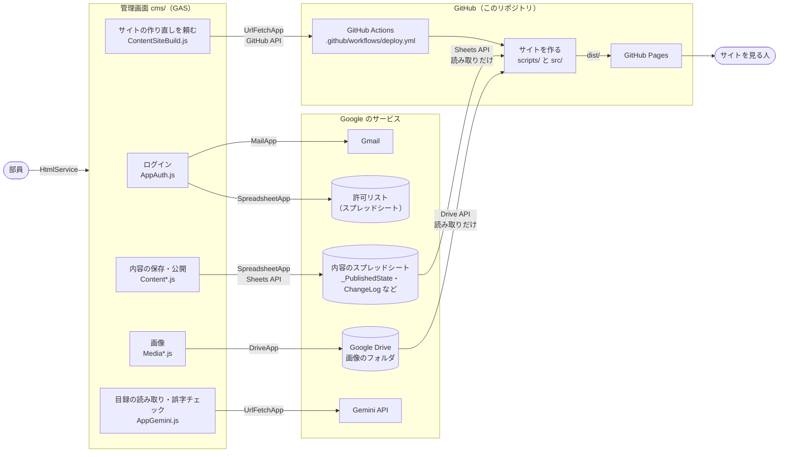
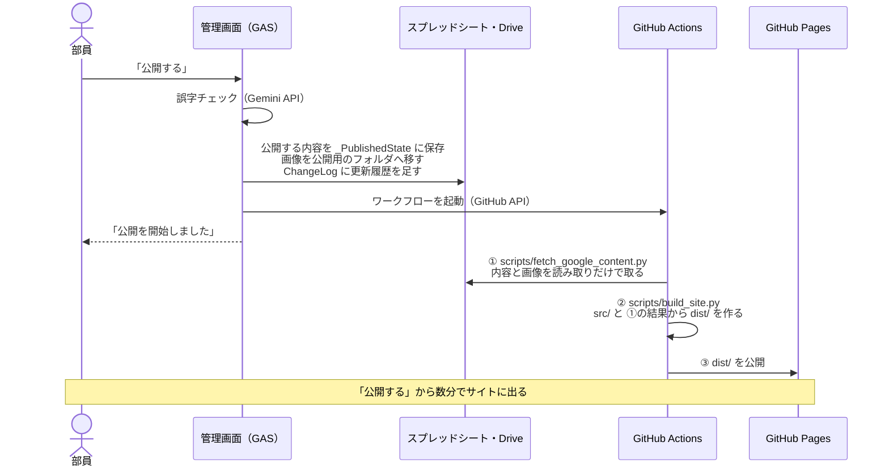

# 凌美会ホームページ — 引き継ぎ資料

凌美会のホームページ（<https://ryobi-art-club.github.io/homepage/>）のリポジトリです。2つの部分でできています。

| 場所 | 役割 |
|---|---|
| このリポジトリの直下（`scripts/`・`src/` など） | **公開サイト**。管理画面で保存された内容から HTML を作り、GitHub Pages で公開する |
| `cms/` | 部員がホームページの内容を編集・公開する**管理画面**。Google Apps Script（GAS）で動く |

2026年11月までは、管理画面を別のリポジトリ（`homepage-cms`。今は非公開のアーカイブ）に置いていました。

**想定している読み手**：プログラミングを少し知っている、後任の部員。GAS や GitHub に慣れていなくても読めるように書いています。

## こんなときは

| したいこと | 読む資料 |
|---|---|
| 全体をざっとつかみたい | このページの「システムの全体像」 |
| 引き継ぐ・引き継がれた | [管理者の手順](docs/operations.md) の「アカウントと権限」（必ず確認） |
| 部員を追加したい、年度替わりの作業をしたい、固定の文章を変えたい | [管理者の手順](docs/operations.md) |
| 部員から相談された、エラーの通知メールが届いた、反映されない | [困ったとき](docs/troubleshooting.md) |
| コードを直したい（最初の環境づくりも） | [コードを直して反映する手順](docs/development.md) と [コードを書くときの決まり](docs/coding-rules.md) |
| 管理画面の作りを調べたい | [管理画面の仕組み](docs/reference/cms.md) |
| 公開サイトの作りを調べたい | [公開サイトの仕組み](docs/reference/site.md) |
| スプレッドシートや保存する形を調べたい・変えたい | [データの約束](docs/reference/data.md) |
| なぜこういう作りなのか知りたい | [設計の判断](docs/decisions.md) |
| システムを一から作り直したい | [一から作り直す手順](docs/setup.md) |

**AI エージェントに作業を頼むとき**：[`AGENTS.md`](AGENTS.md)（全体・公開サイト・管理画面）に作業の決まりごとをまとめています。

## システムの全体像

図は Mermaid という書き方で描いています。GitHub ではそのまま図として表示されます。VS Code のプレビューで見るには、拡張機能「Markdown Preview Mermaid Support」が必要です。

- 矢印の上の文字は、使っている Google や GitHub の機能です。GAS の中だけで使う機能（`CacheService` など）は、下の「使っている機能の一覧」にあります。
- **データの置き場所はスプレッドシートと Drive だけ**です。管理画面にも公開サイトにも、データベースのようなものはありません。
- **公開サイトは「公開する」を押したときにだけ作り直されます。** 定期的な自動更新はありません。押してから数分で反映されます。
- 管理画面での「下書き保存」は、スプレッドシートの内部用のシートに保存するだけで、公開サイトには影響しません。
- 公開サイトに出るのは、管理画面で「公開中」になっている項目だけです。

### どこを直せばよいか

| 変えたいもの | 直す場所 | 反映のしかた |
|---|---|---|
| 展示会・活動記録・新歓・ご依頼の内容 | 管理画面で編集（コードは触らない） | 管理画面の「公開する」 |
| 部員（ログインできる人） | 許可リストのスプレッドシート | すぐ反映（[部員を追加する・外す](docs/operations.md#部員を追加する外す)） |
| サイトの固定の文章（紹介文、活動場所、年間スケジュール、連絡先など） | `src/site_static.json` | push してから「公開する」か手動実行（[固定の文章や画像を変える](docs/operations.md#固定の文章や画像を変える)） |
| サイトの見た目・動き | `src/stylesheet.css`・`src/site.js`・`scripts/sitebuild/` | 同上（[公開サイトの見た目や動きを変えるとき](docs/development.md#公開サイトの見た目や動きを変えるとき)） |
| ロゴ・部室の写真 | `src/logo.png`・`src/clubroom.jpg` | 同上 |
| サイトがスプレッドシートや Drive から読む部分 | `scripts/fetch_google_content.py` | 同上。管理画面と同じデータを読むので、[データの約束](docs/reference/data.md) も合わせて直す |
| 管理画面の画面 | `cms/Ui*.html` | `clasp push` してデプロイ（[管理画面を反映する](docs/development.md#管理画面を反映する)） |
| 管理画面の保存・公開・画像・ログインの処理 | `cms/` の `.js` ファイル（[管理画面の仕組み](docs/reference/cms.md)） | 同上 |
| サイトを作り直す手順そのもの | `.github/workflows/deploy.yml` | push すると次の公開から使われる |

### 使っている機能の一覧

| 使っている機能 | 使っている場所 | 何に使うか |
|---|---|---|
| `HtmlService` | `cms/AppMain.js` | 管理画面を表示する |
| `SpreadsheetApp`・Sheets API | `cms/Content*.js`・`cms/AppAuth.js` | 内容と許可リストを読み書きする（Sheets API はまとめて速く読むため） |
| `DriveApp` | `cms/Media*.js` | 画像とフォルダを扱う |
| `MailApp` | `cms/AppAuth.js`・`cms/AppErrorReport.js` | 確認コードと、管理者へのエラー通知を送る |
| `CacheService` | `cms/AppAuth.js`・`cms/AppErrorReport.js` | 確認コード・ログインの状態・回数の上限を覚えておく（最長6時間） |
| `LockService` | `cms/ContentApi.js`・`cms/ContentProofread.js`・`cms/MediaApi.js` | 2人が同時に保存・公開しても壊れないよう、順番にする |
| `PropertiesService` | `cms/AppConfig.js`・`cms/AppErrorReport.js` | 設定値（Script Properties）を読む |
| `UrlFetchApp` → Gemini API | `cms/AppGemini.js`（`MediaCatalog.js`・`ContentProofread.js` から呼ぶ） | 目録の画像から作品名と作者を読む、公開前に誤字を探す |
| `UrlFetchApp` → GitHub API | `cms/ContentSiteBuild.js` | GitHub App の権限で、サイトを作り直すワークフローを起動する |
| Sheets API・Drive API（サービスアカウント） | `scripts/fetch_google_content.py` | 公開した内容と画像を、読み取りだけの権限で取ってくる |
| GitHub Actions・GitHub Pages | `.github/workflows/deploy.yml`・`check.yml` | サイトを作って公開する。push のたびにテストする |

設定値の一覧は [管理画面の仕組み](docs/reference/cms.md) の「Script Properties（設定値）」にあります。

### 公開サイトの作られ方

- **サイトは自動では作り直されません。** このリポジトリに push しただけでは反映されず、管理画面の「公開する」か、GitHub の「Actions」→「Build and Deploy Ryobi Site」→「Run workflow」で作り直します。
- ページは `index.html` の1枚だけで、タブの切り替えなどは `site.js` で行います。

## 著作権

© 神戸大学美術部凌美会

- このリポジトリのコード・デザイン（CSS）・ロゴ・固定の文章の著作権は、神戸大学美術部凌美会にあります。見ていただくのは歓迎しますが、許可なく使ったり、複製してサイトを作ったりすることはできません。
- サイトに載せている作品の画像の著作権は、それぞれの作者にあります。
- ライセンス（使ってよいという許可）は付けていません。理由は [設計の判断](docs/decisions.md)。
